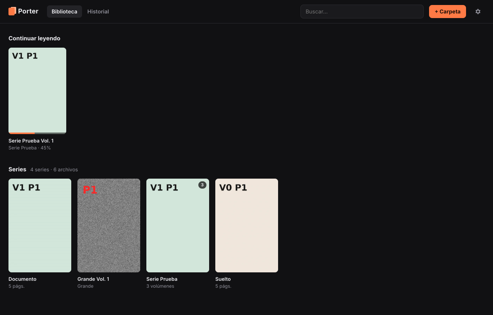
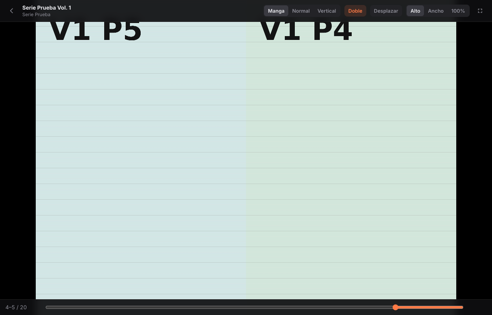
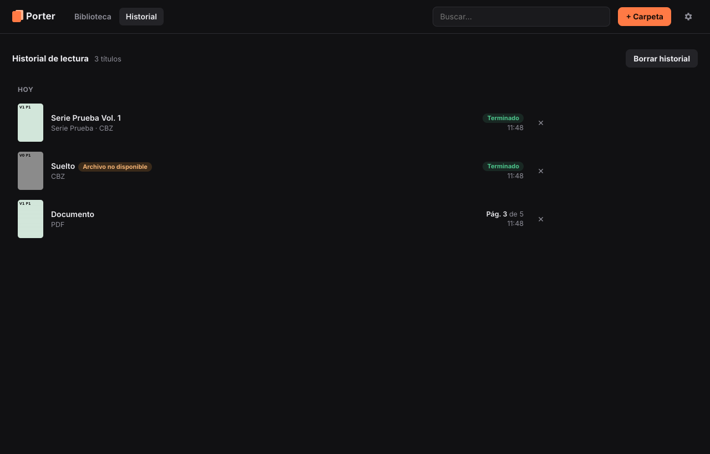

# Porter

Lector de manga, cómics y libros para Windows. Lee **CBZ, ZIP, CBR, RAR y PDF**, organiza tu biblioteca a partir de tus carpetas y recuerda por dónde vas en cada tomo.

*A fast, simple manga/comic reader for Windows (CBZ, CBR, PDF) with right-to-left manga mode, reading progress and a persistent reading history. Free and open source (MIT).*



| Modo manga a doble página | Historial |
|---|---|
|  |  |

## Descargar
Descarga la última versión desde **[Releases](https://github.com/Fireaced/Porter/releases/latest)**. Necesitas los dos archivos: `Porter-x.y.z-win.zip` e `instalar-porter.ps1`.

## Instalar
1. Pon `Porter-x.y.z-win.zip` y `instalar-porter.ps1` en la misma carpeta.
2. Clic derecho en `instalar-porter.ps1` → **Ejecutar con PowerShell**.
3. Si Windows pregunta si confías en el certificado «Porter - Fireaced», pulsa **Sí**. Solo lo pregunta la primera vez.

El script:
- quita al zip la marca de «descargado de Internet», que es lo que hace saltar el aviso de SmartScreen;
- instala Porter en `%LOCALAPPDATA%\Programs\Porter`;
- lo firma con un certificado creado en tu propio PC, que solo es de confianza en ese equipo;
- crea accesos directos en el menú Inicio y en el escritorio.

Para actualizar, vuelve a ejecutarlo con el zip nuevo. Tu biblioteca, progreso e historial no se tocan.
Para instalar sin firmar: `powershell -ExecutionPolicy Bypass -File .\instalar-porter.ps1 -SinFirma`.

También puedes descomprimir el zip y abrir `Porter.exe` directamente. En ese caso, como el ejecutable no está firmado por una autoridad reconocida, SmartScreen avisará la primera vez: «Más información» → «Ejecutar de todas formas».

## Funciones
- **Biblioteca por carpetas vigiladas**: añade una o varias carpetas (botón «+ Carpeta» o arrastrándolas a la ventana). Cada subcarpeta es una serie. Lo que copies o borres aparece o desaparece solo. Sin límite de libros.
- **Continuar leyendo**: Porter guarda la página exacta de cada libro y te devuelve ahí al abrirlo.
- **Progreso**: barra de progreso en cada portada, «✓ Leído» al terminar y «X de Y leídos» por serie. Clic derecho para marcar como leído/no leído.
- **Modo manga** (derecha → izquierda), modo normal y modo vertical (webtoon). Porter recuerda el modo de cada serie.
- **Doble página**: detecta las páginas dobles apaisadas y las muestra solas; «Desplazar» corrige el emparejado si queda descuadrado.
- **Historial**: todo lo que lees queda guardado con portada, página y fecha, aunque el archivo se borre o se mueva («Archivo no disponible»). Si vuelve a aparecer, se reconecta solo y continúa donde lo dejaste.
- Al terminar un tomo te ofrece abrir el siguiente de la serie.

## Reportar fallos y sugerencias
Pulsa el icono del bicho (arriba a la derecha, también dentro del lector) o ve a **Ajustes → Reportar un fallo o sugerencia**. El reporte llega de forma privada al autor y no se publica en ningún sitio.

Si marcas «Adjuntar información técnica», se añade la versión de Porter y de Windows, la pantalla, la GPU, los ajustes de lectura y los últimos errores internos. Nunca se envían nombres de archivos ni rutas: Porter los sustituye por `<carpeta>` o `<ruta>` antes de enviar. Con «Ver qué se envía» puedes revisarlo antes.

Si no hay conexión, el reporte se guarda y se envía la próxima vez que abras Porter.

## Calidad y rendimiento
- Las imágenes se muestran con sus bytes originales, sin recomprimir.
- Los PDF se renderizan a la resolución exacta de tu pantalla (incluido el escalado de Windows y el zoom).
- Los CBZ se leen página a página sin descomprimir el archivo entero. Los CBR se extraen en segundo plano a una caché (máx. 3 GB, se limpia sola) y puedes empezar a leer en cuanto sale la primera página.
- Paso de página instantáneo: las 3 páginas (o dobles) siguientes y la anterior ya están decodificadas y escaladas a la resolución exacta de tu pantalla (con remuestreo de alta calidad), dibujadas en lienzos propios y ocultas detrás de la actual. Pasar página solo cambia cuál se ve.
- Además, Porter tiene en memoria los bytes de las siguientes 10 páginas y las 5 anteriores. Puedes cambiarlo a 5, 20 o 40 en Ajustes → Páginas precargadas.
- Si saltas muy lejos (barra o Inicio/Fin), la página actual se queda en pantalla mientras carga la nueva, con una línea fina arriba, y la nueva aparece con un fundido corto.

## Atajos del lector
| Tecla | Acción |
|---|---|
| ← / → | Página (en modo manga, ← avanza) |
| Espacio / Re Pág / Av Pág | Siguiente / anterior |
| Inicio / Fin | Primera / última página |
| F o F11 | Pantalla completa |
| M | Cambiar modo (Manga → Normal → Vertical) |
| D | Doble página |
| Ctrl + rueda, + / − / 0 | Zoom (arrastra para moverte) |
| Esc | Salir |

Clic en el tercio izquierdo/derecho de la pantalla para pasar página y en el centro para mostrar/ocultar las barras.

## Compilar desde el código
Requiere [Node.js](https://nodejs.org) 20 o superior.
```
npm install
npm start          # ejecutar en modo desarrollo
npm run dist       # generar dist/Porter-x.y.z-win.zip
```
Los datos (biblioteca, progreso, historial, portadas) se guardan en `%APPDATA%\porter`.

### Estructura
- `src/main/`: proceso principal de Electron (biblioteca y vigilancia de carpetas, lectura de CBZ/CBR, protocolo `porter://`, guardado de datos).
- `src/renderer/`: interfaz (biblioteca, historial y lector).
- `build/`: icono y script que escribe los metadatos de `Porter.exe`.

## Contribuir
Los *issues* y *pull requests* son bienvenidos. Si encuentras un fallo, indica el modo de lectura, el tipo de archivo (CBZ/CBR/PDF) y cómo reproducirlo.

## Licencia
[MIT](LICENSE): puedes usar, copiar, modificar y distribuir Porter libremente, también con fines comerciales, siempre que mantengas el aviso de copyright y la licencia.

Porter usa [Electron](https://www.electronjs.org/), [pdf.js](https://mozilla.github.io/pdf.js/), [yauzl](https://github.com/thejoshwolfe/yauzl), [node-unrar-js](https://github.com/YuJianrong/node-unrar.js) y [chokidar](https://github.com/paulmillr/chokidar), cada uno con su propia licencia. La descompresión de RAR se basa en el código fuente de UnRAR de RARLAB, que permite su uso pero no crear un compresor RAR a partir de él.
